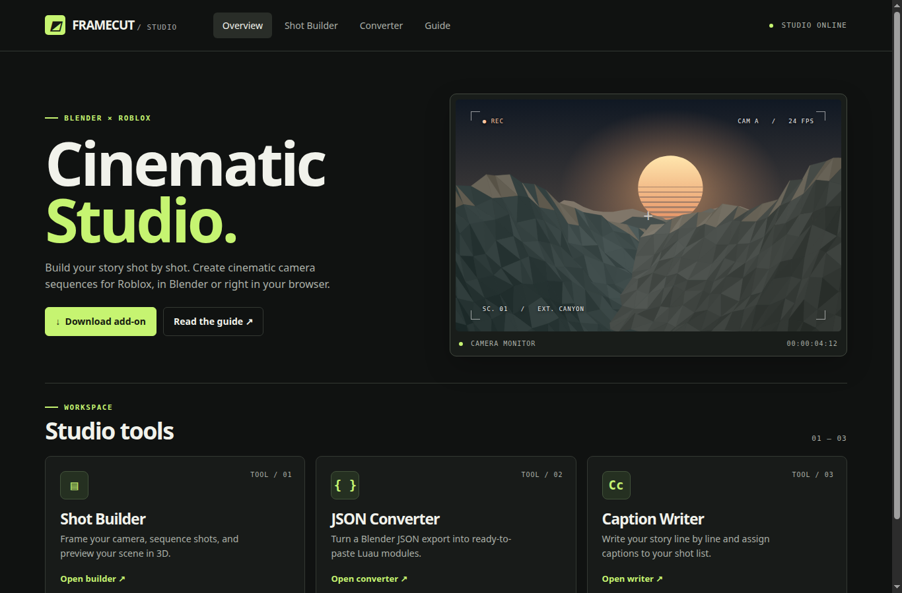

<!-- coderabbit-ai-generated:v1 -->

# Framecut · Roblox Cinematic Studio

Author portrait-friendly Roblox cinematics in Blender, or build a shot list on your phone. Both workflows produce a CutsceneData ModuleScript for the included client player. No database, accounts, animation uploads or API keys are required to use the tools.

[Phone shot editor screenshot](docs/builder-mobile.png) · [Blender beginner guide](docs/guide.md) · [Troubleshooting and limitations](docs/troubleshooting.md)

## Start on your phone

1. Open the deployed website → **Shot Builder**. Edit Shot1, then choose **Add shot**. Each shot is a fixed camera pose in Roblox world space: studs, Y up, and local −Z forward. Rotation is intrinsic XYZ in degrees; FOV is vertical. The preview shows framing in a sample 9:16 scene.
2. Use **Duplicate**, **Move up/down**, or **Delete** to edit the sequence. Valid changes save in this browser. Invalid fields show an explanation; correct them before exporting. Download project JSON for a backup, or to move to another device.
3. Open **Caption Writer**, enter one line per shot and assign. Blank lines work. Return to the builder and choose **Generate Luau**. Copy or download each output module.
4. In Studio, insert ModuleScripts named **CutscenePlayer** and **CutsceneData** under ReplicatedStorage. Replace the entire source with roblox/CutscenePlayer.lua and the generated data, respectively. If the generator emits Part1, Part2, etc., create those ModuleScripts **inside CutsceneData**. Put roblox/StartCutscene.client.lua in a **LocalScript under StarterPlayer → StarterPlayerScripts**. Click **Play**. Space or a tap stops playback.

## Install the Blender workflow

Download **blender-addon/roblox_cinematic_exporter.zip** (also available from the website). In Blender Preferences → Add-ons, select **Install** or **Install from Disk**, choose the zip, then enable Roblox Cinematic. Press N in the viewport and open its tab. The [guide](docs/guide.md) walks through a complete two-shot example. Use **JSON Converter** for Blender's exported version-1 JSON; **Import project JSON** in the builder is for editable Framecut projects. Conversion happens on your device in a worker. For large inputs use the file picker (32 MiB maximum).

## Run locally

Install Node.js 22 or later. In the extracted project folder (the one containing package.json):

    npm ci
    npm test
    npm start

Open http://localhost:3000. The server listens on PORT when set, otherwise 3000. GET /health returns {"status":"ok"}. No build step. The site loads Three.js from a pinned CDN with a local fallback. Express renders the guide from the two Markdown files in docs.

## Put this project on GitHub — computer

1. Download the repository archive and extract it. Open a terminal **inside the folder containing package.json**, not its parent. Install Git and sign in to your GitHub account.
2. On github.com choose **+ → New repository**. Choose your account, name it **roblox-cinematic-studio**, set visibility and click **Create repository**. For this method leave the README, license and gitignore options unchecked.
3. Run the following commands (replace YOUR-USERNAME with your GitHub login). If Git asks for a name/email, set your Git identity before committing. When pushing, authenticate using your credential manager.

       git init -b main
       git add .
       git commit -m "Add Framecut cinematic studio"
       git remote add origin https://github.com/YOUR-USERNAME/roblox-cinematic-studio.git
       git push -u origin main

4. Refresh the repository page. Confirm package.json, railway.json, LICENSE and the blender-addon, roblox, docs and web folders are at the top level.

## Put it on GitHub — phone browser

This route preserves directories, binary files and hidden files using a GitHub Codespace. It requires Codespaces access and available quota. Use your browser's **Request desktop site** option if toolbar buttons are hidden.

1. Download **framecut-studio.zip** to your phone. Keep it zipped. On github.com create a repository named **roblox-cinematic-studio**. **Enable “Add a README file”** for this phone method so the repository has a main branch.
2. Open your repo → **Code → Codespaces → Create codespace on main**. Wait for the browser editor. Open Explorer, press and hold (or open the context menu on) the repository root, choose **Upload**, then select framecut-studio.zip.
3. In the editor choose **Terminal → New Terminal**. At the repository root run:

       unzip -o framecut-studio.zip
       rm framecut-studio.zip
       git add .
       git commit -m "Add Framecut cinematic studio"
       git push origin main

   The archive contains files at its root; extraction replaces the starter README. Do not upload only the unopened zip as your repository contents.
4. Return to github.com and check the root contains package.json and web/. Stop the Codespace when finished.

## Deploy on Railway

1. Sign in to [Railway](https://railway.com/) and choose **New Project → Deploy from GitHub repo**. Connect GitHub if asked. Grant Railway's GitHub app access to the repository you just created.
2. Select **roblox-cinematic-studio** and branch **main**. Leave Root Directory at the repository root. Railway can install from package-lock.json and start the Express server using railway.json. Do not add a database, secrets, or a fixed PORT variable.
3. If presented with staged changes, click **Deploy**. Open the service's **Deployments** tab, select the deployment and check the logs. Wait for a successful deployment and health check.
4. Open the service → **Settings → Networking → Public Networking → Generate Domain**. Use Railway's detected application port. Tap the generated HTTPS domain to open your studio. Append **/health** to the URL to confirm it returns status ok.
5. Future pushes to the connected branch can redeploy the website. If the build cannot find package.json, check the root directory and make sure you extracted the project archive before committing. See [Railway public networking](https://docs.railway.com/guides/public-networking) for domain settings.

## Project map

| Path | Contents |
|---|---|
| blender-addon/ | Single-file Blender add-on and its installable zip |
| roblox/ | Strict Luau player and starter LocalScript |
| web/ | Static editor, background converter, Three.js preview and styles |
| docs/ | Beginner guide, troubleshooting and screenshots |
| tests/ | Data validation, orientation and module splitting checks |
| server.js | Express static server, guide renderer and health endpoint |

## Known limitations

Blender lighting, materials and visual effects do not transfer; recreate the stage in Studio. R15 motor joint axes must match the converted Blender rest axes. The browser builder authors fixed camera poses; use Blender for animated paths, objects and bones. Browser projects are local to the device and origin, with up to 250 shots and 8,000 caption characters per shot. Make JSON backups. The browser preview is a framing reference, not a Roblox renderer. Studio playback and actual phone recording should be tested before publishing.

MIT-licensed. See LICENSE.
